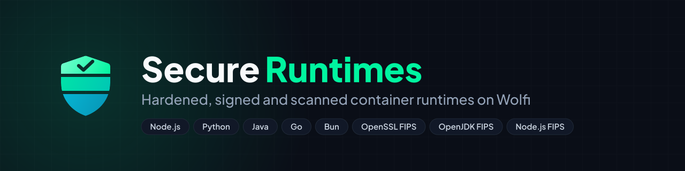

<p align="center"></p>

# High-Assurance Secure Container Runtimes

[](#2-fips-140-3)
[](https://github.com/wolfi-dev)
[](#3-supply-chain-slsa-build-level-3)
[](LICENSE)

Hardened container base images on [Wolfi](https://github.com/wolfi-dev), built for both `linux/amd64` and `linux/arm64`, signed with SLSA Build Level 3 provenance and scanned on every rebuild. The FIPS images ship FIPS 140-3 validated cryptographic modules; read [what that covers](#2-fips-140-3) before relying on it for FedRAMP, DoD or similar programs.

---

## 🌟 Supported Runtimes & Flavors

| Runtime | Versions | Flavors | FIPS 140-3 module | Base OS |
| :--- | :--- | :--- | :--- | :--- |
| **OpenJDK FIPS** | `8`, `17`, `21`, `25` (LTS) | `dev`, `standard`, `distroless` | Bouncy Castle `bc-fips` 2.1.1, CMVP [#4943](https://csrc.nist.gov/projects/cryptographic-module-validation-program/certificate/4943) | Wolfi |
| **OpenSSL FIPS** | `3.5.9` core | `dev`, `standard`, `distroless` | OpenSSL FIPS Provider 3.1.2, CMVP [#4985](https://csrc.nist.gov/projects/cryptographic-module-validation-program/certificate/4985) | Wolfi |
| **Node.js FIPS** | `22`, `24` | `dev`, `standard`, `distroless` | OpenSSL FIPS Provider 3.1.2, CMVP #4985 | Wolfi |
| **Go FIPS** | `1.22` to `1.27` | `dev`, `prod` | Go's BoringCrypto (`GOEXPERIMENT=boringcrypto`) | Wolfi |
| **BoringSSL** | `20240528` | `dev`, `standard`, `distroless` | Built with `-DFIPS=1`, **not validated** ([why](boringssl/README.md)) | Wolfi |
| **Java** | `17`, `21`, `23` | `dev`, `prod` | None | Wolfi |
| **Node.js** | `18`, `20`, `22`, `24`, `26` | `dev`, `prod` | None, use Node.js FIPS | Wolfi |
| **Go** | `1.22` to `1.27` | `dev`, `prod` | None, use Go FIPS | Wolfi |
| **Python** | `3.10` to `3.14` | `dev`, `prod` | None | Wolfi |
| **Bun** | `1` | `dev`, `prod` | None | Wolfi |

---

## 🛡️ Security Architecture & Controls

### 1. Hardened base
- **Shell-less flavors:** the `distroless` flavors of OpenSSL, BoringSSL, OpenJDK and Node.js FIPS have no shell and no package manager. The `prod` images of Node.js, Go, Go FIPS, Python, Bun and Java are wolfi-base without its package database, so they still contain busybox `/bin/sh` (and, except Node.js, the `apk` binary).
- **Non-root users:** OpenSSL and BoringSSL run as `65532` (`nonroot`), OpenJDK FIPS as `1001`, Node.js FIPS and the runtime images as `1000`.
- **Vulnerability scans:** every rebuilt image is scanned with Trivy for HIGH and CRITICAL findings, and the results are on the dashboard. Images without an apk database (the `prod` images listed above) hide their OS packages from the scanner, so their reports cover language packages and binaries only.

### 2. FIPS 140-3
A CMVP certificate validates a **module** on the operational environments its security policy lists, not an image. None of these images run on a tested environment: the OpenSSL provider was tested on Intel x86_64 Ubuntu, Debian, FreeBSD, Windows and macOS and on Apple M1 macOS, and bc-fips is tested as a Java library. Running the modules on Wolfi, and especially on Linux arm64, is an operator-affirmed port (FIPS 140-3 Implementation Guidance 2.3.A).

- **[OpenJDK FIPS](openjdk/README.md):** Eclipse Temurin 8, 17, 21 and 25 with Bouncy Castle `bc-fips` 2.1.1, `bcutil-fips` and `bctls-fips`. `java.security` puts BCFIPS first and BCFKS as the default keystore, and `JAVA_TOOL_OPTIONS` sets `approved_only=true`. The Sun, SunRsaSign, SunEC and SunJCE providers stay registered after BCFIPS, so code that asks for an algorithm without naming a provider (MD5, DES, JKS) can still get a non-validated implementation. `bc-fips` 2.1.1 has open CVEs, fixed only in versions no certificate covers yet.
- **[OpenSSL FIPS](openssl/README.md):** OpenSSL 3.5.9 core with the FIPS Provider 3.1.2 built from the validated source. `openssl.cnf` loads only the FIPS and base providers with `default_properties = fips=yes`, so default algorithm fetches come from the module; an application can still load other providers explicitly.
- **Node.js FIPS:** Wolfi's Node.js loads the OpenSSL FIPS Provider 3.1.2 through `OPENSSL_CONF`, `OPENSSL_MODULES` and `NODE_OPTIONS=--force-fips`, so MD5, ChaCha20 and RSA-1024 are refused. Those are environment variables: a deployment that overrides them turns FIPS mode off. Every build runs `/usr/share/nodejs-fips/fips-check.js`.
- **Go FIPS:** the `dev` image builds with `CGO_ENABLED=1` and `GOEXPERIMENT=boringcrypto`, so programs compiled there route `crypto/*` to Go's BoringCrypto module. Restricting TLS to FIPS cipher suites needs `import _ "crypto/tls/fipsonly"` in your program. The `prod` image is a plain runtime base for those binaries; it contains a prebuilt `/usr/share/go-fips/fips-check` and no Go toolchain.
- **[BoringSSL](boringssl/README.md):** built from a pinned BoringSSL commit with `-DFIPS=1`, which adds the module integrity check and self-tests (`bssl isfips`). It is **not** the CMVP-validated BoringCrypto module and has no approved-only mode.

### 3. Supply chain (SLSA Build Level 3)
- **Provenance:** every image is built, merged and attested inside one reusable workflow, [`build-images.yml`](.github/workflows/build-images.yml). The SLSA provenance is signed through Sigstore with that workflow's OIDC identity, which the calling workflow cannot use or forge. That isolation is what SLSA Build Level 3 requires. Verify an image with:

  ```bash
  gh attestation verify oci://ghcr.io/taha2samy-3/openssl-fips:3.5.9 --owner taha2samy-3 \
    --signer-workflow taha2samy-3/node/.github/workflows/build-images.yml
  ```

  Images last rebuilt before this workflow existed are signed by `build.yml` and only pass without `--signer-workflow` until their next rebuild.
- **SBOMs:** a CycloneDX SBOM per architecture is attested to GHCR (`--predicate-type https://cyclonedx.org/bom`) and uploaded to GitHub's dependency graph. SBOMs are not stored inside the images.
- **Scanning:** Trivy vulnerability scans, the Docker CIS benchmark and the Chainguard STIG profile run on every rebuilt image and are published on the dashboard.

---

## 🚀 Quick Start

### Pulling from GHCR

```bash
# OpenJDK 21 FIPS (Production Distroless)
docker pull ghcr.io/taha2samy-3/wolfi-openjdk-fips:21-distroless

# OpenSSL 3.5 FIPS (Production Distroless)
docker pull ghcr.io/taha2samy-3/openssl-fips:3.5.9-distroless

# BoringSSL FIPS (Production Distroless)
docker pull ghcr.io/taha2samy-3/boringssl-fips:distroless

# Node.js 22 (Production)
docker pull ghcr.io/taha2samy-3/node:22

# Node.js 24 FIPS (Production Distroless)
docker pull ghcr.io/taha2samy-3/node-fips:24-distroless

# Go 1.27 FIPS (Production Base)
docker pull ghcr.io/taha2samy-3/go-fips:1.27
```

---

## 🛠️ Building with Docker Bake

This repository utilizes Docker Buildx Bake (`docker-bake.hcl`) for multi-platform, declarative container builds:

```bash
# Build all OpenJDK FIPS targets (8, 17, 21, 25), or a single one
docker buildx bake openjdk
docker buildx bake openjdk-21-prod

# Build all OpenSSL FIPS targets
docker buildx bake openssl-dev openssl-standard openssl-prod

# Build all BoringSSL FIPS targets
docker buildx bake boringssl-dev boringssl-standard boringssl-prod

# Build all Go FIPS targets (1.22 through 1.27)
docker buildx bake go-fips-dev go-fips-prod

# Build all Node.js targets
docker buildx bake dev-22 prod-22

# Build all Node.js FIPS targets (needs the OpenSSL FIPS image)
docker buildx bake node-fips

# Build the entire default group across all runtimes
docker buildx bake
```

---

## 🧪 Testing & Verification

Every FIPS image has a test suite. CI runs it on amd64 and arm64 after each build and on every pull request that changes the image, and the results appear on the dashboard's **FIPS tests** tab:

| Image | Suite | What it checks |
| :--- | :--- | :--- |
| OpenSSL FIPS | `openssl/tests/` | Provider status and self-tests, approved / rejected digests, ciphers, MACs, KDFs, key sizes and curves, PQC, TLS |
| BoringSSL | `boringssl/tests/` | `bssl isfips` status, SHA-2 digests against Python `hashlib`, DRBG output, cipher lists, RSA/Ed25519 signatures, AES-GCM and HMAC round trips, C-level FIPS indicators |
| OpenJDK FIPS | `openjdk/tests/` | BCFIPS provider order, the `approved_only` system property, algorithms rejected **by the BCFIPS provider** (each negative test names it explicitly), BCFKS keystores, TLS 1.3 (needs internet), DRBG |
| Node.js FIPS | `nodejs/fips/tests/` | `crypto.getFips()`, `setFips(false)` blocked, rejected digests / ciphers / curves / scrypt, RSA sizes, HMAC, PBKDF2, TLS 1.3 handshake, non-root and distroless checks |
| Go FIPS | `go/fips/tests/` | the `fips-check` binary (BoringCrypto active, known-answer tests), the BoringCrypto environment, BoringCrypto symbols in built binaries, non-root execution in `dev` |

```bash
# Run a suite the way CI does, against every flavor of one image (pull or build the images first)
pip install pytest allure-pytest pyyaml
python .github/scripts/fips_tests.py --unit openssl-3.5 --arch amd64 --out fips-results
python .github/scripts/fips_tests.py --unit boringssl-20240528 --arch amd64 --out fips-results
python .github/scripts/fips_tests.py --unit go-fips-1.27 --arch amd64 --out fips-results
python .github/scripts/fips_tests.py --unit openjdk-21 --arch amd64 --out fips-results
python .github/scripts/fips_tests.py --unit node-fips-24 --arch amd64 --out fips-results

# Or call pytest directly against one image
pytest openssl/tests -m "not network" --image ghcr.io/taha2samy-3/openssl-fips:3.5.9
pytest boringssl/tests --image ghcr.io/taha2samy-3/boringssl-fips:latest
pytest go/fips/tests --image ghcr.io/taha2samy-3/go-fips:1.27-dev --flavor dev
pytest nodejs/fips/tests --image ghcr.io/taha2samy-3/node-fips:24-distroless --flavor prod
```

A few OpenSSL tests are marked as strict expected failures. They cover known limits of the certified OpenSSL FIPS provider 3.1.2 (see [openssl/README.md](openssl/README.md)), and the run fails if one of them starts passing.

---

## 🔁 Build, Test and Update Lifecycle

### Per-image builds and scans

Every change rebuilds, re-attests, rescans and republishes on the dashboard **only the images it affects**:

1. `.github/scripts/plan_images.py` gives every bake target a fingerprint: its resolved bake definition, the Dockerfile stages it builds, the local files those stages copy, and the fingerprints of images it consumes (Node.js FIPS consumes the OpenSSL FIPS image).
2. **Build and Push Images** compares that fingerprint with the `io.github.taha2samy-3.build.fingerprint` label of the published image and rebuilds only targets that differ or are not published yet. A build that failed or was cancelled is retried on the next run.
3. **Generate Security Dashboard and Deploy** scans only the rebuilt images (plus any image without a stored report) and keeps the last reports of everything else, which are published with the site under `reports/`.

Examples: bumping `NODE_22_FULL_VERSION` rebuilds `node:22`, `node:22-dev` and `node-fips:22*`; editing `openjdk/conf/java-8.security` rebuilds the three Java 8 images; editing a README rebuilds nothing.

Both workflows can be run by hand: **Build and Push Images** takes `rebuild` (`changed`, `all`, or ids such as `node-22 openjdk`) and the dashboard workflow takes `rescan` (`missing`, `all`, or ids).

### Native amd64 and arm64

Each image is built twice, natively and without QEMU: on `ubuntu-24.04` for `linux/amd64` and on `ubuntu-24.04-arm` for `linux/arm64`. Both builds push by digest, and `.github/scripts/merge_manifests.py` joins them into one multi-platform tag, then checks that both platforms are present. Trivy scans, CIS checks, SBOM attestations and FIPS tests run once per architecture, and the dashboard has an **amd64 / arm64** switch. Provenance is attached to the multi-platform index. Building, merging and attesting all run inside the reusable `build-images.yml` (see SLSA above); `build.yml` only plans the run and calls it once per stage.

### Dependency updates

`.github/dependencies.yml` lists every pinned version and checksum in `docker-bake.hcl` and says how to update it:

- **Certified FIPS modules**: the OpenSSL FIPS Provider 3.1.2 (CMVP certificate [#4985](https://csrc.nist.gov/projects/cryptographic-module-validation-program/certificate/4985)) and Bouncy Castle `bc-fips` 2.1.1 (certificate [#4943](https://csrc.nist.gov/projects/cryptographic-module-validation-program/certificate/4943)). These never change automatically. Only the validated version may be used, so they change by hand when NIST lists a new certificate.
- **Everything else** is updated by **Daily Dependency Update** (`.github/scripts/update_dependencies.py`): Wolfi packages (including every package installed in the OpenSSL images), base images by digest, the OpenSSL 3.5 LTS core source and its SHA-256, Eclipse Temurin JDK / JRE downloads and checksums, the Bouncy Castle TLS / utility jars (checked against Maven Central's `.sha256`), and the envoke release.

The script opens **one pull request per image family** (`runtimes`, `openssl-fips`, `openjdk-fips`, `boringssl-fips`, `base`) on the branch `automation/deps-<group>`, and handles it the way Dependabot does: an open PR is updated in place, a closed one is replaced by a fresh PR, and a group with no updates has its PR closed. Each PR lists the version changes and the images it will rebuild. PRs without a major version bump get the `automerge` label and merge on their own: once the Pull Request Check has built the changed images and passed their FIPS suites on the PR's latest commit, it squash-merges the PR and starts **Build and Push Images**. A PR with a major bump waits for review, and a PR that conflicts with an update merged first is rebased by the next daily run.

[Renovate](renovate.json) runs every day from the self-hosted [`renovate.yml`](.github/workflows/renovate.yml) workflow and updates only the GitHub Actions used by the workflows, pinning them to commit SHAs. Its minor, patch and digest updates merge automatically after a 4-day stability period, and security fixes immediately, but only once every check on the PR has passed: Renovate merges them itself, so nothing merges before the checks finish. Major versions and changes to the Python, Node.js or Ubuntu versions the workflows run on wait for review. Renovate needs a `RENOVATE_TOKEN` secret (a fine-grained token with Contents, Pull requests, Issues and Workflows read/write, and Dependabot alerts read): with the default `GITHUB_TOKEN` it cannot push changes to workflow files, cannot read vulnerability alerts, and its PRs start no CI.

The run also checks coverage, and fails if `docker-bake.hcl` gains a pinned variable (`*_VER`, `*_VERSION`, `*_SHA`, `*_SHA256`, `*_URL`, `*_IMAGE`) that `dependencies.yml` does not list. Run it locally with:

```bash
python .github/scripts/update_dependencies.py --dry-run                       # every group
python .github/scripts/update_dependencies.py --dry-run --group openjdk-fips  # one group
```

### Pull request check

**Pull Request Check** builds the images a pull request changes (linux/amd64, nothing is pushed) and runs the FIPS test suites against them. Make it a required status check in the `main` branch protection rules, so that a dependency update cannot be merged while it breaks an image or its FIPS behaviour. Dependency-update PRs are opened with `GITHUB_TOKEN`, and GitHub holds their `pull_request` runs for a maintainer's approval. The update script therefore dispatches this check on each `automation/deps-*` branch after pushing it and deletes the held runs. The dispatched run reports its result on the PR as the `Pull Request Check` commit status, so make that status the required check.

### Benchmarks and certificate watch

- **FIPS Benchmarks** runs every week on both architectures. It measures each FIPS image against a non-FIPS baseline of the same software: stock OpenSSL on Debian bookworm, this repository's regular Node.js image, and Eclipse Temurin with SunJCE. Results appear on the dashboard's **Benchmarks** tab, where the FIPS / baseline ratio is the number to compare.
- **FIPS Certificate Watch** (`.github/scripts/cmvp_watch.py`) checks the CMVP certificates every week. It opens or updates an issue labelled `fips-certificates` if a certificate is no longer Active, is less than a year from its sunset date, no longer lists the pinned version, or if the vendor has a newer certificate. The dashboard's **FIPS module** tab shows the same status.

---

## 📊 Security & Compliance Dashboard

The repository includes a modern web-based compliance dashboard built with React, Vite, and Tailwind-inspired styling located under `web/`:

```bash
cd web
npm install
npm run dev
```

The dashboard shows, for each image and each architecture (amd64 / arm64):
- Vulnerability posture and CVE breakdown.
- CIS benchmark pass/fail scores.
- Interactive SBOM package explorer.
- SLSA provenance and SBOM attestations, with the `gh attestation verify` commands.
- The FIPS module, its CMVP certificate status and sunset date.
- FIPS test results and benchmark results against non-FIPS baselines.

---

## 📁 Repository Structure

```
├── .github/
│   ├── dependencies.yml        # Every pinned version: certified FIPS modules vs. automatically updated
│   ├── workflows/
│   │   ├── build.yml           # Plans the run, calls build-images.yml per stage, cleanup, FIPS tests
│   │   ├── build-images.yml    # Reusable: native amd64 + arm64 builds, multi-platform merge, attestation (SLSA Build L3)
│   │   ├── packages.yml        # melange FIPS APK packages, published as an APK repository
│   │   ├── docs.yml            # Security scans, CIS checks and the dashboard deployment
│   │   ├── pr-check.yml        # Builds and tests the images a pull request changes
│   │   ├── daily-image-update.yml # Daily dependency update pull requests
│   │   ├── benchmarks.yml      # Weekly FIPS vs. non-FIPS benchmarks
│   │   └── fips-certificates.yml  # Weekly CMVP certificate watch
│   ├── actions/                # bake-build, trivy-scan, attest-image, upload-dependency-graph
│   └── scripts/
│       ├── plan_images.py      # Decides which images to build, test, attest and scan
│       ├── merge_manifests.py  # Joins per-architecture digests into multi-platform tags
│       ├── update_dependencies.py # Resolves updates and manages the dependency PRs
│       ├── fips_tests.py       # Runs the FIPS test suite of an image and writes the dashboard report
│       ├── run_benchmarks.py   # FIPS vs. baseline benchmarks (bench/ holds the Node.js and Java programs)
│       └── cmvp_watch.py       # Checks the CMVP certificates of the FIPS modules
├── openjdk/                    # Wolfi OpenJDK FIPS 140-3 images
│   ├── dockerfile              # Multi-stage Wolfi + BCFIPS build
│   ├── conf/java-<v>.security  # Hardened FIPS 140-3 security policy per Java version
│   ├── render_security.py      # Renders conf/java-<v>.security from templates/
│   ├── tests/                  # pytest & JUnit verification suite
│   └── README.md               # OpenJDK module documentation
├── nodejs/                     # Node.js images (regular + FIPS stages)
│   ├── dockerfile              # dev / prod and fips-dev / fips-standard / fips-distroless
│   └── fips/                   # OpenSSL FIPS config, build-time FIPS check and tests/
├── openssl/                    # Wolfi OpenSSL FIPS 140-3 images
│   ├── dockerfile              # Source build with enable-fips, checksum-verified sources
│   ├── conf/openssl.cnf        # Hardened FIPS provider configuration
│   ├── tests/                  # pytest FIPS verification suite
│   └── README.md               # OpenSSL module documentation
├── boringssl/                  # BoringSSL built with -DFIPS=1 (not CMVP-validated)
├── melange/                    # melange packages: OpenSSL FIPS Provider 3.1.2 for Wolfi
├── go/, python/, bun/, java/   # Runtime images (go/ also builds Go FIPS)
├── web/                        # React/Vite security dashboard
│   ├── src/                    # Dashboard pages and components
│   └── runtimes.yaml           # Runtime metadata and report mappings
├── docker-bake.hcl             # All bake targets and pinned versions
├── renovate.json               # Renovate: GitHub Actions updates, SHA pinning, automerge
└── README.md                   # Project root documentation
```

---

## 📄 License

Licensed under the Apache License, Version 2.0. See [LICENSE](LICENSE) for details.